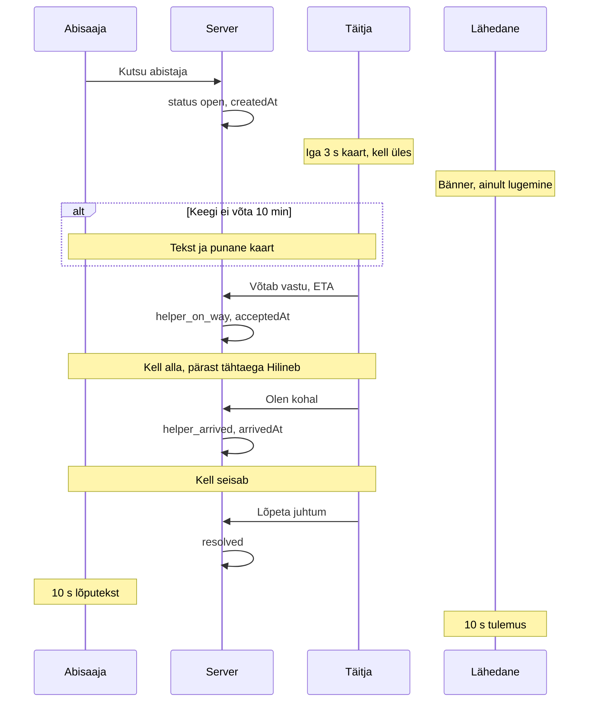

# Kliendi ja täitja kommunikatsioon

Kliendi ja täitja vahel ei ole eraldi sõnumeid ega SMS-e. Teade on juhtum, mis ilmub täitja järjekorda. Mõlemad ekraanid küsivad serverit iga 3 sekundi tagant.

## Lühidalt

Abisaaja vajutab **Kutsu abistaja**. Server loob juhtumi olekuga `open` ja salvestab `createdAt`. Täitja kaardil jookseb kell üles. Kui täitja valib 5, 10, 20 või 40 minutit, läheb olek `helper_on_way`, salvestatakse `acceptedAt` ja mõlemal ekraanil algab kell „Saabumiseni“. Kui tähtaeg möödub, läheb kell punaseks ja loeb „Hilineb +MM:SS“. Täitja vajutab **Olen kohal**: olek `helper_arrived`, `arrivedAt` täitub ja saabumiskell peatub. **Lõpeta juhtum** viib olekusse `resolved` ja kaart kaob. Abisaaja näeb 10 sekundit teksti „Abi on lõpetatud. Hoia end!“.

## Olekud

| Olek | Mida abisaaja näeb | Mida täitja näeb |
|---|---|---|
| `open` | „Kutse on saadetud. Ootame abistajat.“ Nupp kutse tühistamiseks. | Kaart, kell üles, ETA-nupud. |
| `open` üle 10 min | Sama tekst ja suur soovitus „Helista 112“. | Punane ääris, punane kell, silt „Ootab üle 10 min – keegi pole vastu võtnud“. Need kaardid on kõige ülal. |
| `helper_on_way` | „{nimi} on teel“ ja kell alla. Hilinemisel lisatekst 112 kohta. | „Saabumiseni“ või „Hilineb“. Nupp „Olen kohal“ ja „Lõpeta juhtum“. |
| `helper_arrived` | „{nimi} on kohal.“ | „Kohal alates HH:MM“. Kell seisab. Nupp „Lõpeta juhtum“. |
| `resolved` | 10 sekundit „Abi on lõpetatud. Hoia end!“, siis algvaade. | Kaart kaob järgmisel päringul. |
| `cancelled` | Algvaade. Uue kutse saab teha kohe. | Kui täitja oli teel, 30 sekundit „Kutse tühistati abisaaja poolt“. |
| `escalated_112` | „See võib olla terviseoht“ ja nupp 112. | Kaart järjekorras. Praegune kutsenupp seda olekut ei loo. |

## Millal teade tuleb

Teate saavad kliendi küljes olevad täitjad (`client_helpers`): konkreetne inimene või terve organisatsioon. Järjekord on `GET /api/helpers/queue`. Abisaaja vaade on `GET /api/clients/{id}/help`.

Lähedane ja eestkostja näevad sama abi-vaadet profiilil ainult lugemiseks, samuti iga 3 sekundi tagant:

- `open`: „{nimi} kutsus abi kell HH:MM. Ootame abistajat.“
- `helper_on_way`: „{täitja} on teel, saabub ~HH:MM.“
- `helper_arrived`: „{täitja} on kohal.“
- `resolved` või `cancelled`: 10 sekundit „Juhtum lõpetatud: {tulemus}“.

Neil ei ole tühistamise, vastuvõtu ega sulgemise nuppu. Lugemine käib olemasoleva õigusega `view_client`.

## Millal kell käima läheb

| Kell | Kus | Algus | Suund |
|---|---|---|---|
| **Abipalvest** | täitja kaart | `createdAt` | üles. Üle 10 min ja olek `open`: punane. |
| **Saabumiseni** | abisaaja ja täitja | `acceptedAt` + ETA | alla kuni 00:00, siis punane „Hilineb +MM:SS“ |
| **10 minuti ooteaeg** | serveri lipp `waitingTooLong` | `createdAt`, ainult olek `open` | eraldi kella ei ole |

## Millal kell seisma jääb

- **Abipalvest** kaob, kui juhtum ei ole enam aktiivne (`resolved`) või tühistamisteade on 30 sekundit näidatud.
- **Saabumiseni** peatub olekus `helper_arrived`. Enne seda ei peatu nullis, vaid loeb hilinemist.
- **10 minuti lipp** kaob, kui olek ei ole enam `open`.

## Kes mida teha saab

Õigused on serveris `backend/permissions.ts`. Nupud peidab liides.

| Tegevus | Kes | Millal |
|---|---|---|
| Kutsu abi | abisaaja (`client_elder`) | aktiivset juhtumit ei ole |
| Tühista kutse | sama abisaaja | `open` või `helper_on_way`. Kinnitus on nupu teine olek. |
| Võta vastu | kliendi täitja | ainult `open`. Kui keegi jõudis enne, vastus 409: „Kutse võttis juba vastu {nimi}“. |
| Olen kohal | määratud täitja või organisatsiooni koordinaator | `helper_on_way` |
| Lõpeta juhtum | määratud täitja või koordinaator | `helper_on_way` või `helper_arrived`. Tulemus: `helped_up`, `called_112` või `other` (märkus kuni 500 märki). |
| Lähtesta demo | süsteemi admin | kinnitus „Kinnita lähtestamine“, seejärel `POST /api/admin/reset`. |

Teine täitja näeb vastuvõetud kutset halli tekstiga „Kutse võttis juba vastu {nimi}“ ja ETA-d, ilma vastuvõtunuppudeta. Kella eraldi nulli panna ei saa. Uus kutse aktiivse juhtumi peale aega ei nulli.

